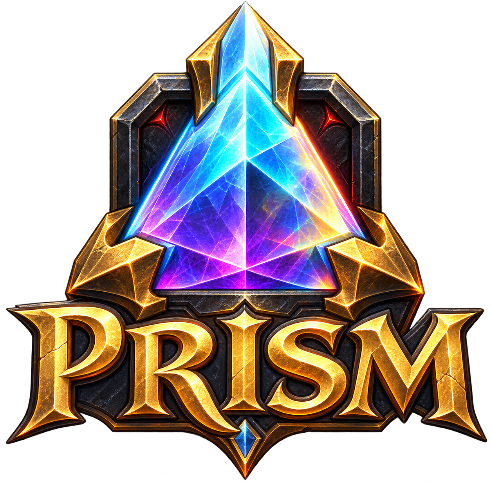

# Prism

A World of Warcraft Forever addon that makes action buttons respond visually to gameplay situations.



## Features

### General

- _Racial buffs:_ **Shadowmeld**, **Elune's Light** — Highlights while the player has the action's buff.
  Target selection and action usability do not affect the highlight.
- _Item buffs:_ Highlights an item while the player has a helpful aura with the same ID as the item's use spell.
  This includes **Night Watchman's Torch**. Target selection and action usability do not affect the highlight.
  Different aura IDs and passive equipment buffs require explicit rules.
- _Bandages:_ Highlights **bandages** while the heal target has full health. A usable bandage blinks red while the heal target has a poison debuff.
- _Healing potions:_ Highlights **healing potions** while the player is alive and has full health. The current target and action usability do not affect the highlight.
- _Mana potions:_ Highlights **mana potions** while the player is alive and has full mana. The current target and action usability do not affect the highlight.
- _Poison cleansing:_ Glows **Anti-Venom**, **Strong Anti-Venom**, **Powerful Anti-Venom**, and **Potent Anti-Venom** while the item is usable and the heal target has a poison debuff.
- _Disease cleansing:_ Glows **Simple Poultice**, **Clever Poultice**, **Superior Poultice**, and **Powerful Poultice** while the item is usable and the heal target has a disease debuff.

Spell actions require explicit aura rules. Shared aura rules cover the declared racial buffs and automatic item buff matching.
Only Druid declarations use same-or-stronger rank matching.
Warrior and Hunter use their explicit mechanics and the shared rules.
Undeclared spell actions receive no automatic buff highlight.

### Warrior

- _Own target debuffs:_ **Rend** — Highlights while the target has the player's debuff.
- _Shared target debuffs:_ **Hamstring**, **Demoralizing Shout**, **Thunder Clap** — Highlights while the target has the matching debuff.
- _Shared target debuff stacks:_ **Sunder Armor** — Highlights when fully stacked.
- _Tanking:_ **Taunt**, **Mocking Blow**, **Challenging Shout** — Highlights while the player tanks the target.
- _Usable attacks:_ **Execute**, **Overpower**, **Revenge**, **Victory Rush** — Glows while the spell is usable.
- _Interrupts:_ **Shield Bash** — Glows during a hostile target cast or channel while the spell is usable.
- _Fear warning:_ **Intimidating Shout** — Blinks red while the spell is usable and the hostile target has **Rend** or **Deep Wound** from any caster.

### Hunter

- _Own target debuffs:_ **Serpent Sting** — Highlights while the target has the player's matching debuff.
- _Shared target debuffs:_ **Hunter's Mark**, **Concussive Shot**, **Wing Clip**, **Scorpid Sting**, **Viper Sting** — Highlights while the target has the matching debuff from any caster.
- _Sting replacement warning:_ A usable **Serpent Sting**, **Viper Sting**, or **Scorpid Sting** blinks red while the target has the player's different sting. Another hunter's sting does not activate the warning.
- _Usable attacks:_ **Mongoose Bite**, **Counterattack** — Glows while the spell is usable.
- _Threat reduction:_ **Disengage** — Glows while the player tanks a living hostile target and the action is usable.
- _Pet healing:_ **Mend Pet** — Highlights while the player's living pet has full health. The highlight does not require a usable action.
- _Pet feeding:_ **Feed Pet** — Highlights while the living pet is Happy or has the Feed Pet Effect buff. Action usability does not affect the highlight. Glows only without the buff, while the action is usable and the living pet is below Happy and out of combat.
- _Pet revival:_ **Revive Pet** — Highlights while the player's pet is alive. The highlight does not require a usable action.

The client exposes three pet happiness states. Feed Pet uses the highest state, Happy, not an exact happiness percentage.
The active Feed Pet Effect buff suppresses the glow and keeps the highlight.

### Druid

Druid aura highlights accept the action rank or a stronger rank within each declared spell family.
A weaker rank does not activate these highlights. Caster filters still apply.
Different spell families remain separate, even when their effects are similar.

- _Buff highlights:_ **Mark of the Wild**, **Thorns**, **Regrowth**, **Rejuvenation**, **Abolish Poison**.
  Each spell highlights while the heal target has an equal or stronger rank from any caster.
- _Player-only buffs:_ **Enrage**, **Nature's Grasp**, **Prowl** — Each button highlights while its matching buff is active on the player.
  Target selection and action usability do not affect these highlights.
- _Own target debuffs:_ **Moonfire**, **Rip**, **Rake** — Highlights while the target has the player's matching debuff.
- _Finisher glow:_ **Rip** — Glows at exactly five combo points on the current target while the action is usable.
  The debuff highlight remains independent of the glow.
- _Energy feedback:_ **Shifting Power** — Highlights while the living player has full energy, regardless of action usability.
  Below full energy, a usable action blinks red if its 40-energy gain exceeds the player's missing energy.
  Both conditions follow the player's maximum energy.
- _Shared target debuffs:_ **Entangling Roots**, **Bash**, **Demoralizing Roar**, **Faerie Fire**, **Hibernate**, **Soothe Animal**.
  Each button highlights while the target has the matching debuff from any caster.
  Entangling Roots also matches the auras from Nature's Grasp. Action usability does not affect these highlights.
- _Tanking:_ **Growl**, **Challenging Roar** — Highlights while the player tanks a living hostile target. Action usability does not affect the highlight.
- _Taunt glow:_ **Growl** — Glows in a party or raid while the player does not tank a living hostile target.
  The action must be usable. A target without threat data also activates the glow.
- _Missing target debuff:_ **Faerie Fire** — Glows while the action is usable and a living hostile target lacks an equal or stronger debuff.
  Any caster's equal or stronger rank suppresses the glow. The debuff highlight remains independent of action usability.
- _Threat reduction:_ **Cower** — Glows while the action is usable and the player tanks a living hostile target.
- _Interrupts:_ **Bash** — Glows during a hostile target cast or channel while the spell is usable.
- _Healing:_ **Healing Touch**, **Regrowth**, **Rejuvenation** — Highlights while the heal target is alive and has full health.
  Action usability does not affect the highlight. Regrowth and Rejuvenation keep their independent buff highlights.
- _Curse cleansing:_ **Remove Curse** — Glows while the action is usable and the heal target has a curse debuff.
- _Poison cleansing:_ **Abolish Poison** — Glows while the action is usable and the heal target has a poison debuff.
  The active buff also highlights the button.
- _Self-buff glow:_ **Mark of the Wild**, **Thorns** — Each spell requires a usable action.
  The spell glows when the player lacks an equal or stronger buff and is the heal target.
  Another assistable target disables the glow. A weaker buff activates the glow.
  Any caster's equal or stronger buff suppresses the glow.

## Installation

- Download Prism from [CurseForge](https://www.curseforge.com/wow/addons/prism).
- Extract Prism into the `Interface/AddOns/` directory for the Forever client.
- Restart WoW, or type `/reload` if the game is open.

## Architecture

The main file selects the shared rules and the current class rules. The core contains no class-specific branches.
Class files compose tested mechanics through rule tables and small Lua helpers. They contain no frame operations or gameplay callbacks.

| File                  | Responsibility                                                                                          |
| --------------------- | ------------------------------------------------------------------------------------------------------- |
| `Rules.lua`           | Provides rule helpers, validates declarations and rank lists, and resolves glow dependencies.           |
| `Core.lua`            | Implements action matching, mechanics, visuals, secure aura containers, placement, and refresh control. |
| `Shared.lua`          | Defines class-independent rules and item IDs.                                                           |
| `Classes/Warrior.lua` | Defines Warrior spell IDs, aura IDs, and feedback rules.                                                |
| `Classes/Hunter.lua`  | Defines Hunter spell IDs, aura IDs, and feedback rules.                                                 |
| `Classes/Druid.lua`   | Defines Druid spells, ordered ranks, related aura IDs, and feedback rules.                              |
| `Prism.lua`           | Selects the rules and starts the core.                                                                  |

The TOC loads these files in that order. Add each class file after `Shared.lua` and before `Prism.lua` in `Prism.toc`.

### Rules

Each rule defines a unique `key`, an `action` selector, a `condition`, and a `visual`.

Action selectors match spell IDs, item IDs, or item categories. Spell selectors also match the base spell ID.
`anySpell` matches all spell actions. `anyItem` matches all item actions.
Aura filters use declared IDs or the spell IDs selected by the condition.

Keep action IDs separate from aura IDs. Set `includeActionSpellID` only when the spell action can also identify the aura.
This flag requires a spell selector and adds only the current spell action ID.
Set `includeItemSpellID` to add the item's use spell ID from `C_Item.GetItemSpell`. This flag requires an item selector.
Neither flag infers triggered effects, spell families, or ranks.
If item data is not cached, the core requests it and retries on later refreshes.
A missing use spell produces an empty ID filter unless the condition declares other IDs. An empty ID filter admits no aura.
Use `auraSpellIDs` without `includeItemSpellID` for an explicit item mapping.
Several rules can apply to one action. Each aura rule uses a separate secure container for its filter and alpha.

Set `auraSpellIDsByAction` to provide a separate aura ID set for each action ID.
The map must cover the selector's spell IDs. It cannot accompany `auraSpellIDs`.
The core selects the map entry for the current action or its base spell.
`Rules.RankedAura` builds these maps from class declarations. The core needs no global spell catalog.
Rank matching compares declared ranks, not live aura amounts or talent bonuses.
The client selects active auras through secure filters. Addon Lua does not read aura data to compare ranks.

| Mechanic         | Condition                                                                                   |
| ---------------- | ------------------------------------------------------------------------------------------- |
| `aura`           | A matching buff or debuff is active on the selected unit.                                   |
| `aura-stacks`    | A matching aura reaches the specified application count.                                    |
| `dispel-type`    | A debuff with the specified dispel type is active on the selected unit.                     |
| `alive`          | The selected unit exists and is alive.                                                      |
| `full-health`    | The selected unit exists, is alive, and has full health.                                    |
| `full-mana`      | The selected unit exists, is alive, and has full mana, regardless of its active power type. |
| `full-power`     | The living player has full power of the declared type.                                     |
| `power-overflow` | The declared power amount exceeds the living player's missing power, unless `excludeFull` excludes full power. |
| `combo-points`   | The player has exactly the declared combo-point count on the current target.                |
| `pet-happiness`  | The living pet matches the declared happiness state or is below it when `below` is true.    |
| `usable`         | The action is usable.                                                                       |
| `self-target`    | The heal target is the player.                                                              |
| `target-cast`    | A living hostile target casts or channels.                                                  |
| `hostile-target` | The target exists, is hostile, and is alive.                                                |
| `tanking`        | The player tanks the living hostile target, unless `invert` is true.                        |

The unit can be `player`, `pet`, `target`, `heal-target`, or `buff-target`.
The heal target is an assistable current target, or the player if no assistable target exists.
The buff target is the heal target for helpful spells that are not self-only buffs.
Self-only buffs and other spells select the player.
The core uses `C_Spell.IsSpellHelpful` and `C_Spell.IsSelfBuff` to select the buff target.
Use `buff-target` only for helpful aura conditions with a spell selector.

Set `requireUsable` on a rule to require a usable action. This modifier also applies to `target-cast` rules.
Set `points` on a `combo-points` condition to require an exact positive count on the current target.
Restricted combo-point counts do not activate the visual.
Set `powerType` on a `full-power` condition to test the living player's declared power resource.
The maximum must be positive and unrestricted.
Set `powerType` and a positive integer `amount` on a `power-overflow` condition to test player power waste.
The threshold follows maximum power. Restricted maximum power values do not activate the visual.
Set `excludeFull` to prevent a `power-overflow` visual at full power.
Set `outOfCombat` on a `pet-happiness` condition to require the pet to be out of combat.
Set `invert` on a `tanking` condition to require that the player does not tank the living hostile target.
A target without threat data satisfies this inverted condition.
Set `grouped` on a `tanking` condition to require a party or raid. This modifier applies with or without `invert`.

Aura filters support `HELPFUL`, `HARMFUL`, `HELPFUL|PLAYER`, and `HARMFUL|PLAYER`.
A raw aura condition must pair the `PLAYER` filter with `ownAura = true`.
A false or absent `ownAura` flag keeps every caster.
Dispel conditions require `HARMFUL` and a declared `dispelType`.

Set `suppressGlow` on a plain `aura` rule to reference a non-aura glow rule.
The glow selector must cover every action that the aura rule selects.
Rule order does not affect this dependency. Each suppressor uses a separate secure aura group with one layout element.
The client moves the glow outside the viewport while a matching aura is active.
An empty or disabled group contributes no displacement. The core chains group anchors for multiple suppressors.
Addon Lua does not read aura-owned objects or secure layout geometry.
The suppression follows aura presence, not an application count.
Public size anchors resize aura-driven glows without calls on aura-owned frames.

The visuals are `highlight`, `red-blink`, and `glow`. A suppressor can use `none` to omit its visible feedback.
The core keeps condition alpha separate from animation alpha.
Separate frames combine secret conditions without a Lua comparison. Aura slots remain under client control.

### Rule helpers

Use `local Rules = Prism.Rules` in a declaration file.

| Helper                                      | Result                                                                                       |
| ------------------------------------------- | -------------------------------------------------------------------------------------------- |
| `Rules.TargetDebuff(auraSpellIDs, options)` | Returns a target debuff condition.                                                           |
| `Rules.UsableGlow(key, spellIDs)`           | Returns a complete usable-action glow rule.                                                  |
| `Rules.Union(...)`                          | Returns the union of ID sets without changes to the input sets.                              |
| `Rules.RankedAura(key, ranks, options)`     | Returns a complete aura rule with the same and stronger aura ranks for each declared action. |

`RankedAura` requires `unit` and a base `filter` of `HELPFUL` or `HARMFUL`.
List the ranks from weakest to strongest. A numeric rank uses the same ID for its action and aura.
A structured rank has a `spellID` and an `auraSpellIDs` set for distinct or additional aura IDs.
Related aura IDs do not become action selectors. The helper does not change the rank list or the options.
The helper includes the action ID only when every declared action also identifies its aura.
The optional fields are `ownAura`, `applications`, `visual`, `requireUsable`, and `suppressGlow`.
`ownAura` adds the `PLAYER` filter and the caster check. `applications` selects `aura-stacks`.
The default visual is `highlight`. A suppressor can use `visual = "none"` with `suppressGlow`.

For example, a declared buff family can use this rule:

```lua
Rules.RankedAura("ranked-buff", buffRanks, {
    unit = "heal-target",
    filter = "HELPFUL",
})
```

`TargetDebuff` supports `ownAura`, `includeActionSpellID`, and `applications` options.
It derives both caster checks from `ownAura`. It selects `aura-stacks` when `applications` is set.
It does not infer aura IDs from action IDs or rank-filter its declared aura IDs.

For example, an own target debuff can use this declaration:

```lua
{
    key = "own-debuff",
    action = { spellIDs = actionSpellIDs },
    condition = Rules.TargetDebuff(auraSpellIDs, { ownAura = true }),
    visual = "highlight",
}
```

Use explicit rule tables for other combinations. Do not add a helper for each concrete spell.

`Prism.Start` calls `Rules.Prepare` before it creates the controller or action overlays.
The validator checks keys, fields, selectors, mechanics, visuals, units, ID sets, caster checks, and glow dependencies.
It returns the rules in dependency order without changes to the declarations.

### Validation

Use Lua 5.1 for the syntax checks and tests.

```bash
luac5.1 -p Rules.lua Core.lua Shared.lua Prism.lua Classes/*.lua tests/*.lua tests/PrismTest/PrismTest.lua
lua5.1 tests/rules.lua
lua5.1 tests/mechanics.lua
lua5.1 tests/composition.lua
lua5.1 tests/runtime.lua
lua5.1 tests/probe.lua
bash -n install.sh
bash -n tests/install.sh
bash tests/install.sh
```

| Test file               | Coverage                                                                                                                                                                         |
| ----------------------- | -------------------------------------------------------------------------------------------------------------------------------------------------------------------------------- |
| `tests/rules.lua`       | Tests helpers and validators with synthetic IDs, then validates and selects every declared class through the TOC.                                                                |
| `tests/mechanics.lua`   | Tests resource overflow, full-power exclusion, combo points, threat, groups, selectors, rank filters, and aura filters. Also tests item use spells, delayed data, unit changes, and resource highlights. All tests use synthetic IDs. |
| `tests/composition.lua` | Tests independent visuals, health, rank-aware buff and debuff glows, cleansing, usability, pet combat, and secure aura suppression with synthetic IDs.                           |
| `tests/runtime.lua`     | Tests visuals, animation, events, refresh intervals, bar discovery, placement, reuse, and security guards.                                                                       |
| `tests/probe.lua`       | Tests the standalone test addon, combat steps, report persistence, and controls.                                                                                                 |

Keep behavior tests at the mechanic level with synthetic IDs and rule declarations.
A spell that uses tested mechanics needs no new behavior test.
Extend an existing mechanic or helper test for missing coverage. Do not add scenarios for behavior that existing tests cover.
The generic rule tests validate each class loaded through the TOC. They do not duplicate production spell lists or class support policies.
Do not keep class-specific, spell-specific, or racial-specific automated behavior tests in the repository.
Use a temporary test outside the repository to reproduce a declaration-only bug, then remove it after validation.
Keep a persistent regression test only when it adds missing mechanic or helper coverage with synthetic data.

The mock does not reproduce aura selection, texture rendering, or client security restrictions.
Configuration validation cannot prove that a spell ID or mechanic expresses the intended behavior.
Verify spell IDs against client data and test the affected behavior in the client.

#### Client checks

Use [Prism Test](tests/PrismTest/README.md) for the isolated secure layout experiment.
Install it with `bash tests/install-probe.sh`.

Before release, verify the declared spell IDs in version-matched `SpellName` and `SpellEffect` data.
Verify rank order against `Spell.NameSubtext_lang` and class membership against `SkillLineAbility`.
This verification must use the exact Forever client build.

Run `./install.sh` to install every source file listed in the TOC. Set `PRISM_ADDON_DIRECTORY` to install in another directory.
Use `/reload`, then run every applicable client check in and out of combat.
The checks must produce no Lua error or blocked-action error.

| Feature                   | Check                                                                                                                                                                                                                                                                                                                                                   | Expected result                                                                                                                                                                                                                     |
| ------------------------- | ------------------------------------------------------------------------------------------------------------------------------------------------------------------------------------------------------------------------------------------------------------------------------------------------------------------------------------------------------- | ----------------------------------------------------------------------------------------------------------------------------------------------------------------------------------------------------------------------------------- |
| Druid buff highlights     | Test the declared targetable Druid buffs on the player and another assistable target. Apply and remove equal and stronger ranks.                                                                                                                                                                                                                        | Each declared targetable buff follows the heal target. Only the selected unit's equal or stronger rank activates the highlight.                                                                                                     |
| Druid player-only buffs   | Apply and remove Enrage, Nature's Grasp, and Prowl on the player. Test every declared rank. Trigger Nature's Grasp against an enemy. Change targets and action usability.                                                                                                                                                                               | Only the matching player buff activates each highlight. Equal or stronger Nature's Grasp and Prowl ranks count. The triggered root does not keep the Nature's Grasp highlight active.                                               |
| Racial buffs              | Apply and remove each supported racial on characters from different classes. Change target selection and action usability.                                                                                                                                                                                                                              | Each action highlights only for its own active buff on the player. Other targets and racial buffs do not activate it.                                                                                                               |
| Item buffs                | Apply and remove a buff whose aura ID matches the item use spell ID. Test Night Watchman's Torch. Change targets and action usability. Test an item without a use spell. Change action pages and item placement. | Only the matching player buff activates the item highlight. Other aura IDs and spell actions do not activate it. Target selection and usability do not affect it. |
| Druid self buffs          | Apply and remove weaker, equal, and stronger Mark and Thorns ranks from different casters. Select the player, another assistable target, an enemy, or no target. Change action usability. Test flight and player death.                                                                                                                                 | Each usable spell glows when the player lacks an equal or stronger buff and is the heal target. A weaker buff activates the glow. An unusable spell does not glow.                                                                  |
| Explicit buff scope       | Test undeclared Druid spells and buffs on Warrior, Hunter, and unsupported classes.                                                                                                                                                                                                                                                                     | No automatic buff highlight appears. Existing explicit mechanics continue.                                                                                                                                                          |
| Druid healing             | Test all three spells at full and partial health on the player and an assistable target. Test death, hostile targets, and no target. Apply and remove Regrowth and Rejuvenation. Change action usability.                                                                                                                                               | The full-health highlight requires a living heal target at full health. Buff highlights remain independent. Action usability does not affect either highlight.                                                                      |
| Own target debuffs        | Compare the player's Rend, Serpent Sting, Moonfire, Rip, or Rake with another caster's copy. Test every declared rank. Change action usability and targets.                                                                                                                                                                                             | Only the player's aura activates the highlight. Druid rules require an equal or stronger rank. Warrior and Hunter rules match their declared IDs.                                                                                   |
| Shared target debuffs     | Compare Viper Sting and Scorpid Sting from different hunters. Test Entangling Roots from direct casts and Nature's Grasp, with different casters. Test Bash, Demoralizing Roar, Faerie Fire, Hibernate, and Soothe Animal from different druids. Test every declared rank. Change action usability and targets. Test the other declared shared debuffs. | Druid rules require an equal or stronger rank from any caster. Other class rules match their declared IDs. Usability does not affect these highlights.                                                                              |
| Sting replacement warning | Apply each sting from the player and another hunter. Change the action usability and target.                                                                                                                                                                                                                                                            | Only the player's different sting activates the red warning on a usable action. The matching sting and another hunter's stings do not activate it.                                                                                  |
| Aura stacks               | Change Sunder Armor from four stacks to five stacks, then back to four stacks.                                                                                                                                                                                                                                                                          | The highlight appears only at five stacks.                                                                                                                                                                                          |
| Fear warning              | Apply and remove Rend or Deep Wound from different casters. Change Intimidating Shout usability and target hostility.                                                                                                                                                                                                                                   | The warning blinks red only with a matching hostile target debuff and a usable action.                                                                                                                                              |
| Dispel feedback           | Test poison, disease, and curses on the player and an assistable target. Remove the debuff or make the action unusable.                                                                                                                                                                                                                                 | Bandages blink for poison. Cleansing items and spells glow for their declared dispel type. No debuff or an unusable action hides the visual.                                                                                        |
| Druid cleansing           | Test Remove Curse with curses and Abolish Poison with poison on the player and another assistable target. Apply and remove the Abolish Poison buff separately from the poison debuff. Change action usability and targets.                                                                                                                              | Each usable spell glows only for its matching debuff on the heal target. The Abolish Poison buff highlight remains independent of the poison glow and action usability.                                                             |
| Bandage health            | Test full health, partial health, a dead friendly target, and no assistable target.                                                                                                                                                                                                                                                                     | Only a living heal target at full health activates the highlight. No assistable target selects the player.                                                                                                                          |
| Healing potions           | Change player health. Select friendly targets with different health. Test no target, death, and an unusable potion.                                                                                                                                                                                                                                     | Only a living player at full health activates the highlight. The current target and action usability do not affect the highlight.                                                                                                   |
| Mana potions              | Change player mana. Change druid forms. Select friendly targets with different mana. Test no target, death, and an unusable potion.                                                                                                                                                                                                                     | Only a living player at full mana activates the highlight. The current target, active power type, and action usability do not affect the highlight.                                                                                 |
| Pet health                | Change pet health. Dismiss, replace, or kill the pet. Make Mend Pet unusable.                                                                                                                                                                                                                                                                           | Only a living pet at full health activates the highlight. Usability does not affect the highlight.                                                                                                                                  |
| Pet feeding               | Test each happiness state with and without the Feed Pet Effect buff. Dismiss, replace, or kill the pet. Change Feed Pet usability. Change pet combat separately from player combat.                                                                                                                                                                     | Happy or the active buff activates the highlight, regardless of usability or pet combat. The active buff suppresses the glow. Without the buff, the glow requires a living pet below Happy and out of combat, with a usable action. |
| Pet revival               | Test a living pet with full or partial health. Dismiss, replace, or kill the pet. Make Revive Pet unusable.                                                                                                                                                                                                                                             | Only a living pet activates the Revive Pet highlight. Pet health and action usability do not affect the highlight.                                                                                                                  |
| Usable attacks            | Change the usability of each declared usable attack.                                                                                                                                                                                                                                                                                                    | The glow appears only while the action is usable.                                                                                                                                                                                   |
| Energy feedback           | Test Shifting Power at 60, 61, 70, 99, and 100 energy with a 100-energy maximum. Change action usability, Druid forms, and maximum energy. Test player death. | At a 100-energy maximum, a usable action blinks red from 61 to 99 energy. Full energy activates only the normal highlight, regardless of usability. At 60 energy or less, neither visual appears. Player death hides both visuals. |
| Rip glow                  | Build and spend combo points on an enemy. Change targets and action usability. Apply and remove Rip. Test every declared rank.                                                                                                                                                                                                                          | A usable Rip glows only at exactly five combo points on the current target. The debuff highlight remains independent of the count and usability.                                                                                    |
| Interrupts                | Test hostile casts, hostile channels, no cast, a friendly target, and a dead target. Change Bash and Shield Bash usability.                                                                                                                                                                                                                             | Each spell glows only for a living hostile target cast or channel while usable.                                                                                                                                                     |
| Bash feedback             | Make Bash unusable while the target has another druid's Bash. Remove the stun and test hostile casts and channels with a usable Bash.                                                                                                                                                                                                                   | An equal or stronger stun rank activates the highlight regardless of usability. A hostile cast or channel activates the glow only while Bash is usable. Neither visual requires the other.                                          |
| Tanking                   | Gain and lose target threat with Growl, Challenging Roar, and the Warrior taunts. Select a friendly target, a dead target, or no target. Change action usability.                                                                                                                                                                                       | Only tanking a living hostile target activates the highlight. Action usability does not affect the highlight.                                                                                                                       |
| Growl glow                | Gain and lose target threat while solo, in a party, and in a raid. Select an idle enemy without threat data. Change action usability. Test a friendly target, a dead target, and no target.                                                                                                                                                             | A usable Growl glows only while grouped and not tanking a living hostile target. No threat data also permits the glow. The tanking highlight remains independent of usability.                                                      |
| Faerie Fire glow          | Apply and remove weaker, equal, and stronger ranks from different casters. Change action usability and targets. Test a friendly target, a dead target, and no target.                                                                                                                                                                                   | A usable action glows only for a living hostile target without an equal or stronger debuff from any caster. A weaker rank permits the glow. The existing debuff highlight remains independent of usability.                         |
| Threat reduction          | Gain and lose target threat. Change Disengage and Cower usability. Test every declared rank. Select a friendly target, a dead target, or no target.                                                                                                                                                                                                     | Each spell glows only while the action is usable and the player tanks a living hostile target.                                                                                                                                      |
| Placement                 | Test every supported bar. Change UI scale, button size, bar visibility, action pages, and spell placement.                                                                                                                                                                                                                                              | Each visual stays aligned with its button. Hidden bars and replaced actions leave no stale visual.                                                                                                                                  |
