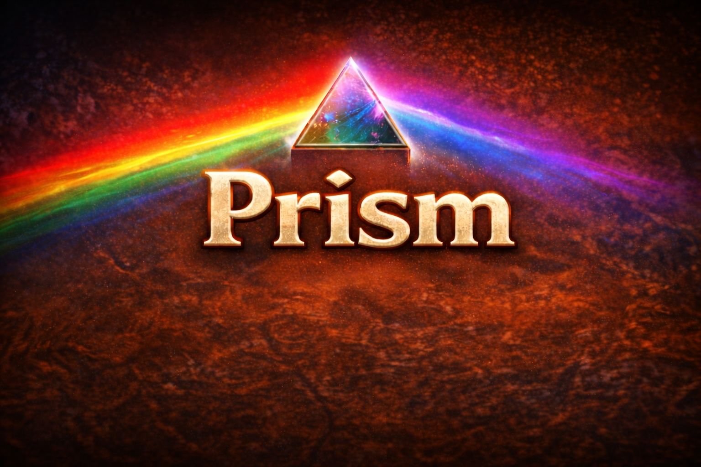

# Prism

A World of Warcraft Forever addon that makes action buttons respond visually to gameplay situations.



## Features

### General

- _Buffs:_ Highlights an action button while the buff target has a buff with the same client spell ID. Targetable helpful buffs use the heal target. Self-only buffs and other spells use the player.
- _Healing:_ Highlights **bandages** while the heal target has full health. A usable bandage blinks red while the heal target has a poison debuff.
- _Poison cleansing:_ Glows **Anti-Venom**, **Strong Anti-Venom**, **Powerful Anti-Venom**, and **Potent Anti-Venom** while the item is usable and the heal target has a poison debuff.
- _Disease cleansing:_ Glows **Simple Poultice**, **Clever Poultice**, **Superior Poultice**, and **Powerful Poultice** while the item is usable and the heal target has a disease debuff.

### Warrior

- _Own target debuffs:_ **Rend** — Highlights while the target has the player's debuff.
- _Shared target debuffs:_ **Hamstring**, **Demoralizing Shout**, **Thunder Clap** — Highlights while the target has the matching debuff.
- _Shared target debuff stacks:_ **Sunder Armor** — Highlights when fully stacked.
- _Tanking:_ **Taunt**, **Mocking Blow**, **Challenging Shout** — Highlights while the player tanks the target.
- _Usable attacks:_ **Execute**, **Overpower**, **Revenge**, **Victory Rush** — Glows while the spell is usable.
- _Interrupts:_ **Shield Bash** — Glows during a hostile target cast or channel while the spell is usable.
- _Fear warning:_ **Intimidating Shout** — Blinks red while the spell is usable and the hostile target has **Rend** or **Deep Wound** from any caster.

### Hunter

- _Own target debuffs:_ **Serpent Sting** — Highlights while the target has the player's matching debuff.
- _Shared target debuffs:_ **Hunter's Mark**, **Concussive Shot**, **Wing Clip**, **Scorpid Sting**, **Viper Sting** — Highlights while the target has the matching debuff from any caster.
- _Sting replacement warning:_ A usable **Serpent Sting**, **Viper Sting**, or **Scorpid Sting** blinks red while the target has the player's different sting. Another hunter's sting does not activate the warning.
- _Usable attacks:_ **Mongoose Bite**, **Counterattack** — Glows while the spell is usable.
- _Threat reduction:_ **Disengage** — Glows while the player tanks a living hostile target and the action is usable.
- _Pet healing:_ **Mend Pet** — Highlights while the player's living pet has full health. The highlight does not require a usable action.
- _Pet feeding:_ **Feed Pet** — Highlights while the living pet is Happy or has the Feed Pet Effect buff. Action usability does not affect the highlight. Glows only without the buff, while the action is usable and the living pet is below Happy and out of combat.
- _Pet revival:_ **Revive Pet** — Highlights while the player's pet is alive. The highlight does not require a usable action.

The client exposes three pet happiness states. Feed Pet uses the highest state, Happy, not an exact happiness percentage.
The active Feed Pet Effect buff suppresses the glow and keeps the highlight.

### Druid

- _Own target debuffs:_ **Moonfire** — Highlights while the target has the player's matching debuff.
- _Shared target debuffs:_ **Entangling Roots** — Highlights while the target has the matching debuff from any caster, including Nature's Grasp.
- _Self buffs:_ **Mark of the Wild**, **Thorns** — Each spell glows while the player lacks every rank of its buff and the heal target is the player. Another assistable target disables the glow. Any caster's matching buff suppresses the glow. Action usability does not affect the glow.

## Installation

- Download Prism from [CurseForge](https://www.curseforge.com/wow/addons/prism).
- Extract Prism into the `Interface/AddOns/` directory for the Forever client.
- Restart WoW, or type `/reload` if the game is open.

## Architecture

The main file selects the shared rules and the current class rules. The core contains no class-specific branches.
Class files compose tested mechanics through rule tables and small Lua helpers. They contain no frame operations or gameplay callbacks.

| File | Responsibility |
| --- | --- |
| `Rules.lua` | Provides rule helpers, validates declarations, and resolves glow dependencies. |
| `Core.lua` | Implements action matching, mechanics, visuals, secure aura containers, placement, and refresh control. |
| `Shared.lua` | Defines class-independent rules and item IDs. |
| `Classes/Warrior.lua` | Defines Warrior spell IDs, aura IDs, and feedback rules. |
| `Classes/Hunter.lua` | Defines Hunter spell IDs, aura IDs, and feedback rules. |
| `Classes/Druid.lua` | Defines Druid spell IDs, aura IDs, and feedback rules. |
| `Prism.lua` | Selects the rules and starts the core. |

The TOC loads these files in that order. Add each class file after `Shared.lua` and before `Prism.lua` in `Prism.toc`.

### Rules

Each rule defines a unique `key`, an `action` selector, a `condition`, and a `visual`.

Action selectors match spell IDs, item IDs, or item categories. The shared buff rule matches any spell action.
Spell selectors also match the base spell ID. Aura filters match only their declared IDs.

Keep action IDs separate from aura IDs. Set `includeActionSpellID` only when the action can also identify the aura.
Several rules can apply to one action. Each aura rule uses a separate secure container for its filter and alpha.

| Mechanic | Condition |
| --- | --- |
| `aura` | A declared buff or debuff is active on the selected unit. |
| `aura-stacks` | A declared aura reaches the specified application count. |
| `dispel-type` | A debuff with the specified dispel type is active on the selected unit. |
| `alive` | The selected unit exists and is alive. |
| `full-health` | The selected unit exists, is alive, and has full health. |
| `pet-happiness` | The living pet matches the declared happiness state or is below it when `below` is true. |
| `usable` | The action is usable. |
| `self-target` | The heal target is the player. |
| `target-cast` | A living hostile target casts or channels. |
| `tanking` | The player tanks the living hostile target. |

The unit can be `player`, `pet`, `target`, `heal-target`, or `buff-target`.
The heal target is an assistable current target, or the player if no assistable target exists.
The buff target is the heal target for helpful spells that are not self-only buffs.
Self-only buffs and other spells select the player.
The core uses `C_Spell.IsSpellHelpful` and `C_Spell.IsSelfBuff` to select the buff target.
Use `buff-target` only for helpful aura conditions with a spell selector.

Set `requireUsable` on a rule to require a usable action. This modifier also applies to `target-cast` rules.
Set `outOfCombat` on a `pet-happiness` condition to require the pet to be out of combat.

Aura filters support `HELPFUL`, `HARMFUL`, `HELPFUL|PLAYER`, and `HARMFUL|PLAYER`.
A raw aura condition must pair the `PLAYER` filter with `ownAura = true`.
A false or absent `ownAura` flag keeps every caster.
Dispel conditions require `HARMFUL` and a declared `dispelType`.

Set `suppressGlow` on a plain `aura` rule to reference a non-aura glow rule.
The glow selector must cover every action that the aura rule selects.
Rule order does not affect this dependency. Each suppressor uses a separate secure aura group with one layout element.
The client moves the glow outside the viewport while a matching aura is active.
An empty or disabled group contributes no displacement. The core chains group anchors for multiple suppressors.
Addon Lua does not read aura-owned objects or secure layout geometry.
The suppression follows aura presence, not an application count.
Public size anchors resize aura-driven glows without calls on aura-owned frames.

The visuals are `highlight`, `red-blink`, and `glow`. A suppressor can use `none` to omit its visible feedback.
The core keeps condition alpha separate from animation alpha.
Separate frames combine secret conditions without a Lua comparison. Aura slots remain under client control.

### Rule helpers

Use `local Rules = Prism.Rules` in a declaration file.

| Helper | Result |
| --- | --- |
| `Rules.TargetDebuff(auraSpellIDs, options)` | Returns a target debuff condition. |
| `Rules.UsableGlow(key, spellIDs)` | Returns a complete usable-action glow rule. |
| `Rules.Union(...)` | Returns the union of ID sets without changes to the input sets. |

`TargetDebuff` supports `ownAura`, `includeActionSpellID`, and `applications` options.
It derives both caster checks from `ownAura`. It selects `aura-stacks` when `applications` is set.
It does not infer aura IDs from action IDs.

For example, an own target debuff can use this declaration:

```lua
{
    key = "own-debuff",
    action = { spellIDs = actionSpellIDs },
    condition = Rules.TargetDebuff(auraSpellIDs, { ownAura = true }),
    visual = "highlight",
}
```

Use explicit rule tables for other combinations. Do not add a helper for each concrete spell.

`Prism.Start` calls `Rules.Prepare` before it creates the controller or action overlays.
The validator checks keys, fields, selectors, mechanics, visuals, units, ID sets, caster checks, and glow dependencies.
It returns the rules in dependency order without changes to the declarations.

### Validation

Use Lua 5.1 for the syntax checks and tests.

```bash
luac5.1 -p Rules.lua Core.lua Shared.lua Prism.lua Classes/*.lua tests/*.lua tests/PrismTest/PrismTest.lua
lua5.1 tests/rules.lua
lua5.1 tests/mechanics.lua
lua5.1 tests/composition.lua
lua5.1 tests/runtime.lua
lua5.1 tests/probe.lua
bash -n install.sh
bash -n tests/install.sh
bash tests/install.sh
```

| Test file | Coverage |
| --- | --- |
| `tests/rules.lua` | Tests helpers and validation, then checks shared rules with every declared class. |
| `tests/mechanics.lua` | Tests mechanics, action selectors, aura filters, item data, and unit changes with synthetic IDs. |
| `tests/composition.lua` | Tests independent feedback, usability gates, pet combat, and secure aura suppression with synthetic IDs. |
| `tests/runtime.lua` | Tests visuals, animation, events, refresh intervals, bar discovery, placement, and reuse. |
| `tests/probe.lua` | Tests the standalone test addon, combat steps, report persistence, and controls. |

A spell that uses tested mechanics needs no spell-specific behavior test.
Add a core test for each mechanic change or untested combination. Add helper tests when a reusable declaration pattern needs code.
The generic rule tests validate each class loaded through the TOC. They do not duplicate spell lists.

The mock does not reproduce aura selection, texture rendering, or client security restrictions.
Configuration validation cannot prove that a spell ID or mechanic expresses the intended behavior.
Verify spell IDs against client data and test the affected behavior in the client.

#### Client checks

Use [Prism Test](tests/PrismTest/README.md) for the isolated secure layout experiment.
Install it with `bash tests/install-probe.sh`.

Before release, verify the declared spell IDs in version-matched `SpellName` and `SpellEffect` data.
This verification must use the exact Forever client build.

Run `./install.sh` to install every source file listed in the TOC. Set `PRISM_ADDON_DIRECTORY` to install in another directory.
Use `/reload`, then run every applicable client check in and out of combat.
The checks must produce no Lua error or blocked-action error.

| Feature | Check | Expected result |
| --- | --- | --- |
| Buff highlights | Apply and remove a matching buff separately on the player and an assistable target. Change targets with targetable buffs and self-only buffs. | Targetable helpful buffs follow the heal target. Self-only buffs keep the player. Only the selected unit's matching buff activates the highlight. |
| Druid self buffs | Apply and remove different Mark and Thorns ranks from different casters. Select the player, another assistable target, an enemy, or no target. | Each spell glows only without any rank of its buff on the player, when the heal target is the player. Action usability does not affect the glow. |
| Own target debuffs | Compare the player's Rend, Serpent Sting, or Moonfire with another caster's copy. | Only the player's debuff activates the highlight. |
| Shared target debuffs | Compare Viper Sting and Scorpid Sting from different hunters. Test Entangling Roots from direct casts and Nature's Grasp, with different casters. Test the other declared shared debuffs. | Each caster's matching debuff activates the highlight. |
| Sting replacement warning | Apply each sting from the player and another hunter. Change the action usability and target. | Only the player's different sting activates the red warning on a usable action. The matching sting and another hunter's stings do not activate it. |
| Aura stacks | Change Sunder Armor from four stacks to five stacks, then back to four stacks. | The highlight appears only at five stacks. |
| Fear warning | Apply and remove Rend or Deep Wound from different casters. Change Intimidating Shout usability and target hostility. | The warning blinks red only with a matching hostile target debuff and a usable action. |
| Dispel feedback | Test poison and disease on the player and an assistable target. Remove the debuff or make the action unusable. | Bandages blink for poison. Cleansing items glow for their declared dispel type. No debuff or an unusable action hides the visual. |
| Bandage health | Test full health, partial health, a dead friendly target, and no assistable target. | Only a living heal target at full health activates the highlight. No assistable target selects the player. |
| Pet health | Change pet health. Dismiss, replace, or kill the pet. Make Mend Pet unusable. | Only a living pet at full health activates the highlight. Usability does not affect the highlight. |
| Pet feeding | Test each happiness state with and without the Feed Pet Effect buff. Dismiss, replace, or kill the pet. Change Feed Pet usability. Change pet combat separately from player combat. | Happy or the active buff activates the highlight, regardless of usability or pet combat. The active buff suppresses the glow. Without the buff, the glow requires a living pet below Happy and out of combat, with a usable action. |
| Pet revival | Test a living pet with full or partial health. Dismiss, replace, or kill the pet. Make Revive Pet unusable. | Only a living pet activates the Revive Pet highlight. Pet health and action usability do not affect the highlight. |
| Usable attacks | Change the usability of each declared usable attack. | The glow appears only while the action is usable. |
| Interrupts | Test hostile casts, hostile channels, no cast, a friendly target, and a dead target. Change Shield Bash usability. | Only a usable Shield Bash glows for a living hostile target cast or channel. |
| Warrior tanking | Gain and lose target threat. Select a friendly target, a dead target, or no target. | Only tanking a living hostile target activates the highlight. Action usability does not affect the highlight. |
| Threat reduction | Gain and lose target threat. Change Disengage usability. Select a friendly target, a dead target, or no target. | Disengage glows only while the action is usable and the player tanks a living hostile target. |
| Placement | Test every supported bar. Change UI scale, button size, bar visibility, action pages, and spell placement. | Each visual stays aligned with its button. Hidden bars and replaced actions leave no stale visual. |
